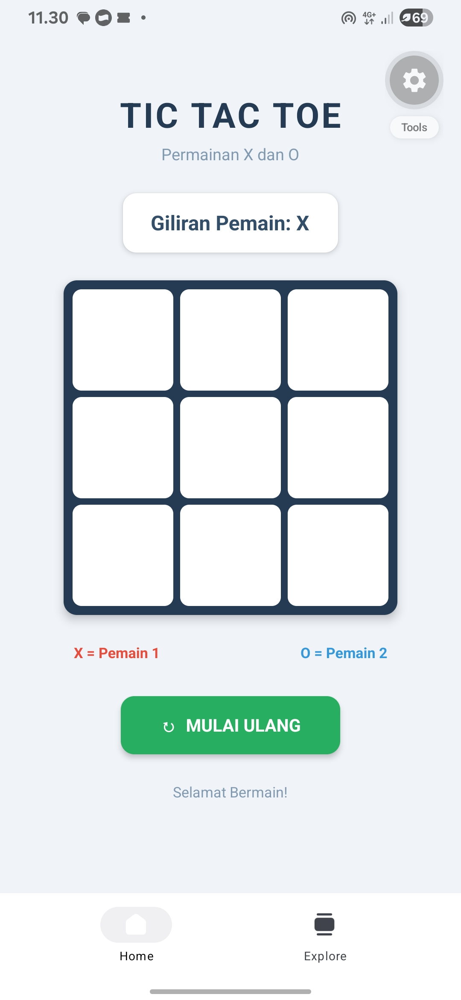

# TicTacToeApp

Aplikasi permainan Tic-Tac-Toe untuk dua pemain dalam satu perangkat.

## Deskripsi Proyek

TicTacToeApp adalah aplikasi permainan X dan O pada papan 3×3. Dua pemain bermain secara bergantian pada perangkat yang sama. Aplikasi memperbarui status giliran, memeriksa kondisi kemenangan setelah langkah, dan menyatakan hasil seri jika papan penuh tanpa pemenang. Permainan dapat dimulai kembali melalui tombol **Mulai Ulang**.

README ini hanya menjelaskan tujuan dan perilaku yang tampak pada implementasi; latar belakang akademik atau masalah khusus yang mendorong pembuatan aplikasi tidak dicantumkan karena belum diketahui.

## Fitur Utama

- Papan permainan berukuran 3×3.
- Pergantian giliran antara pemain X dan pemain O.
- Deteksi pemenang otomatis berdasarkan baris, kolom, dan diagonal.
- Deteksi hasil seri ketika semua kotak terisi tanpa pemenang.
- Kotak yang sudah terisi tidak dapat dipilih kembali.
- Informasi status giliran, pemenang, atau hasil seri.
- Tombol **Mulai Ulang** untuk mengosongkan papan dan memulai dari giliran X.

## Teknologi yang Digunakan

- **TypeScript** untuk kode aplikasi.
- **React Native** untuk membangun antarmuka aplikasi.
- **Expo SDK 58** untuk pengembangan dan menjalankan aplikasi.
- **Expo Router** untuk navigasi berbasis file.
- **npm** untuk instalasi dependency.
- **React Native Reanimated** dan **React Native Worklets** untuk animasi pada komponen pendukung.
- **Expo Image**, **Expo Symbols**, dan **React Native Safe Area Context** untuk dukungan gambar, simbol, dan area aman perangkat.

## Struktur Proyek

| Folder/file | Fungsi |
| --- | --- |
| `src/app/` | Layar dan rute aplikasi. `index.tsx` berisi permainan, `explore.tsx` berisi layar Explore contoh, dan `_layout.tsx` mengatur layout tab, tema, serta splash screen. |
| `src/components/` | Komponen yang digunakan oleh layar, termasuk tab, teks/tampilan bertema, tautan eksternal, komponen collapsible, dan animasi. |
| `src/constants/` | Konstanta aplikasi, seperti warna tema, font, dan spacing. |
| `src/hooks/` | Hook untuk tema dan skema warna. |
| `assets/images/` | Aset gambar seperti ikon aplikasi, ikon tab, splash, dan gambar pendukung. Aset demo Expo di folder ini bukan screenshot aplikasi. |
| `scripts/` | Skrip pemeliharaan starter. `reset-project.js` mereset struktur project; skrip ini dapat memindahkan atau menghapus file, sehingga tidak diperlukan untuk menjalankan aplikasi. |
| `app.json` | Konfigurasi Expo, termasuk nama aplikasi, ikon, splash screen, plugin, dan konfigurasi platform. |
| `package.json` | Metadata, dependency, serta perintah yang tersedia untuk menjalankan aplikasi. |
| `tsconfig.json` | Konfigurasi TypeScript. |

## Persyaratan

- Node.js dan npm.
- Dependency project yang dipasang melalui `npm install`.
- Browser untuk menjalankan versi web, atau perangkat/emulator yang sesuai untuk menjalankan aplikasi native.

Versi minimum Node.js/npm dan daftar perangkat yang telah diuji belum ditentukan dalam konfigurasi project.

## Instalasi

1. Clone repository:

   ```bash
   git clone <repository-url>
   ```

   Ganti `<repository-url>` dengan alamat repository GitHub yang sebenarnya.

2. Masuk ke folder project:

   ```bash
   cd TicTacToeApp
   ```

3. Pasang dependency:

   ```bash
   npm install
   ```

## Menjalankan Aplikasi

Jalankan development server Expo:

```bash
npx expo start
```

Atau gunakan salah satu perintah berikut:

| Perintah | Fungsi |
| --- | --- |
| `npm run android` | Menjalankan Expo dengan target Android. |
| `npm run ios` | Menjalankan Expo dengan target iOS. |
| `npm run web` | Menjalankan aplikasi versi web. |

Ketersediaan target native bergantung pada perangkat dan lingkungan pengembangan yang digunakan.

## Cara Bermain

1. Buka aplikasi dan tampilkan papan permainan.
2. Pemain pertama menggunakan **X**; pemain kedua menggunakan **O**.
3. Pilih kotak kosong pada papan 3×3.
4. Pemain bergantian memilih kotak hingga salah satu pemain menang atau permainan berakhir seri.
5. Tekan **Mulai Ulang** untuk mengosongkan papan dan bermain kembali.

## Screenshot Aplikasi

### Tampilan Awal


### Permainan Berlangsung


## Pengujian

Project belum memiliki hasil pengujian otomatis yang terverifikasi. Tidak ada hasil test yang dapat dilaporkan dalam dokumentasi ini.

## Kontribusi

Kontribusi untuk pengembangan project dapat diajukan melalui perubahan yang terfokus dan pull request. Sertakan ringkasan perubahan serta langkah pengujian yang dilakukan. Pastikan perubahan tetap sesuai dengan fitur dan teknologi yang digunakan project.

## Lisensi

File `LICENSE` yang tersedia menyatakan lisensi **MIT**. File tersebut mencantumkan hak cipta 2015–sekarang atas 650 Industries, Inc. (aka Expo). Silakan merujuk langsung ke file [LICENSE](./LICENSE) untuk ketentuan lengkap.

## Penutup

Terima kasih telah menggunakan atau meninjau TicTacToeApp. Dokumentasi dan kontribusi yang relevan dapat membantu pengembangan project ini.

Untuk informasi pengembangan lebih lanjut, kunjungi [Dokumentasi Expo](https://docs.expo.dev/) dan [Panduan Expo Router](https://docs.expo.dev/router/introduction/).
