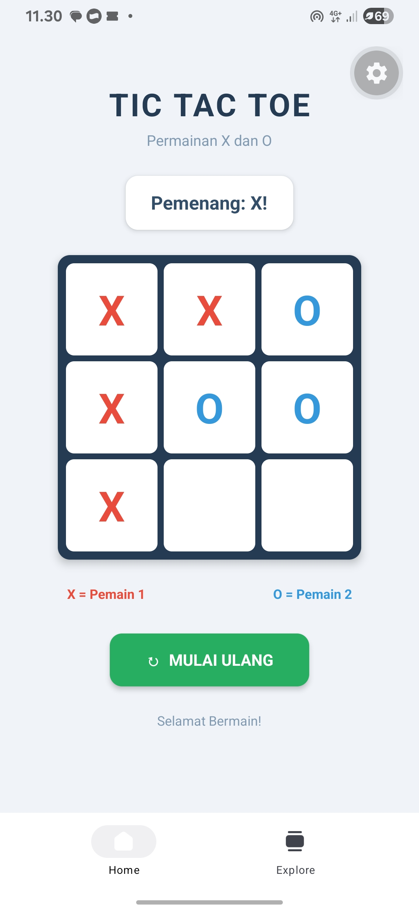

# TicTacToeApp

Aplikasi Tic-Tac-Toe untuk dua pemain—bermain bergantian di satu perangkat dan buktikan siapa yang lebih dulu menang!

## 🎮 Deskripsi Proyek

TicTacToeApp menghadirkan permainan X dan O pada papan 3×3. Dua pemain berbagi satu perangkat dan bergantian memilih kotak. Status giliran selalu ditampilkan, pemenang diperiksa setelah setiap langkah, dan hasil seri diumumkan ketika papan penuh tanpa pemenang. Ingin bermain lagi? Tekan **Mulai Ulang** untuk mengosongkan papan.

## ✨ Fitur Utama

- Papan permainan berukuran 3×3.
- Pergantian giliran antara pemain X dan pemain O.
- Deteksi pemenang otomatis berdasarkan baris, kolom, dan diagonal.
- Deteksi hasil seri ketika semua kotak terisi tanpa pemenang.
- Kotak yang sudah terisi tidak dapat dipilih kembali.
- Informasi status giliran, pemenang, atau hasil seri.
- Tombol **Mulai Ulang** untuk mengosongkan papan dan memulai dari giliran X.

## 🧰 Teknologi yang Digunakan

- **TypeScript** untuk kode aplikasi.
- **React Native** untuk membangun antarmuka aplikasi.
- **Expo SDK 58** untuk pengembangan dan menjalankan aplikasi.
- **Expo Router** untuk navigasi berbasis file.
- **npm** untuk instalasi dependency.
- **React Native Reanimated** dan **React Native Worklets** untuk animasi pada komponen pendukung.
- **Expo Image**, **Expo Symbols**, dan **React Native Safe Area Context** untuk dukungan gambar, simbol, dan area aman perangkat.

## 🗂️ Struktur Proyek

| Folder/file | Fungsi |
| --- | --- |
| `src/app/` | Layar dan rute aplikasi. `index.tsx` berisi permainan, `explore.tsx` berisi layar Explore contoh, dan `_layout.tsx` mengatur layout tab, tema, serta splash screen. |
| `src/components/` | Komponen yang digunakan oleh layar, termasuk tab, teks/tampilan bertema, tautan eksternal, komponen collapsible, dan animasi. |
| `src/constants/` | Konstanta aplikasi, seperti warna tema, font, dan spacing. |
| `src/hooks/` | Hook untuk tema dan skema warna. |
| `assets/images/` | Aset gambar seperti ikon aplikasi, ikon tab, splash, dan gambar pendukung. Aset demo Expo di folder ini bukan screenshot aplikasi. |
| `scripts/` | Skrip pemeliharaan starter. `reset-project.js` mereset struktur project; skrip ini dapat memindahkan atau menghapus file, sehingga tidak diperlukan untuk menjalankan aplikasi. |
| `app.json` | Konfigurasi Expo, termasuk nama aplikasi, ikon, splash screen, plugin, dan konfigurasi platform. |
| `package.json` | Metadata, dependency, serta perintah yang tersedia untuk menjalankan aplikasi. |
| `tsconfig.json` | Konfigurasi TypeScript. |

## ✅ Persyaratan

- Node.js dan npm.
- Dependency project yang dipasang melalui `npm install`.
- Browser untuk menjalankan versi web, atau perangkat/emulator yang sesuai untuk menjalankan aplikasi native.


## 📦 Instalasi

Ikuti langkah berikut untuk menyiapkan project:

1. Clone repository. Ganti `<repository-url>` dengan alamat repository GitHub yang sebenarnya:

   ```bash
   git clone <repository-url>
   ```

2. Masuk ke folder project:

   ```bash
   cd TicTacToeApp
   ```

3. Pasang dependency:

   ```bash
   npm install
   ```

## 🚀 Menjalankan Aplikasi

Mulai development server Expo dengan perintah:

```bash
npx expo start
```

Untuk memilih target secara langsung, gunakan salah satu perintah berikut:

| Perintah | Fungsi |
| --- | --- |
| `npm run android` | Menjalankan Expo dengan target Android. |
| `npm run ios` | Menjalankan Expo dengan target iOS. |
| `npm run web` | Menjalankan aplikasi versi web. |

Ketersediaan target native bergantung pada perangkat dan lingkungan pengembangan yang digunakan.

## 🕹️ Cara Bermain

1. Buka aplikasi hingga papan permainan tampil.
2. Pemain pertama menggunakan **X**, lalu pemain kedua menggunakan **O**.
3. Pilih kotak kosong pada papan 3×3.
4. Bergantian memilih kotak hingga ada pemain yang menang atau permainan berakhir seri.
5. Siap bermain lagi? Tekan **Mulai Ulang** untuk mengosongkan papan.

## 🖼️ Screenshot Aplikasi

### Tampilan Awal


### Permainan Berlangsung




## 📄 Lisensi

Project ini menggunakan lisensi **MIT**. File `LICENSE` mencantumkan hak cipta 2015–sekarang atas 650 Industries, Inc. (aka Expo). Baca [LICENSE](./LICENSE) untuk melihat ketentuan lengkap.

## 👋 Penutup

Terima kasih telah mencoba atau meninjau TicTacToeApp. Dokumentasi dan kontribusi yang relevan akan membantu pengembangan project ini.

Untuk informasi pengembangan lebih lanjut, kunjungi [Dokumentasi Expo](https://docs.expo.dev/) atau [Panduan Expo Router](https://docs.expo.dev/router/introduction/).
